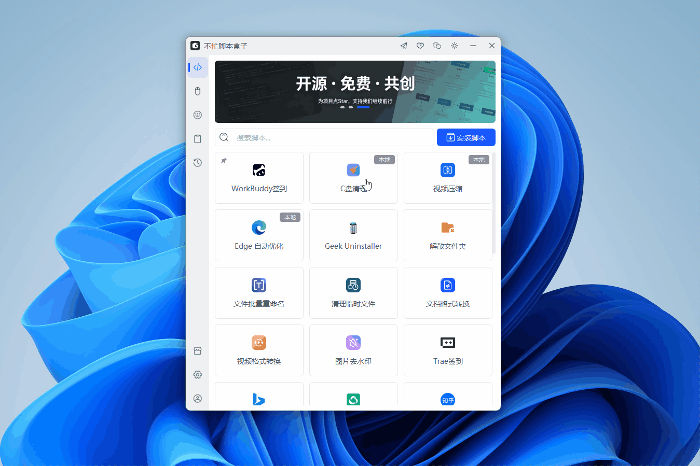

# C盘清理

> 基于 Python 的 Windows C 盘清理脚本，通过不忙脚本盒子渲染启动窗口，支持预览扫描与一键清理。

---

## 核心特性

- **21 个清理项**：临时文件、浏览器缓存、缩略图、着色器缓存、错误报告、回收站、还原点、休眠文件等
- **自定义勾选**：选择“自定义清理项”后直接勾选 21 个开关，按需清理
- **Winapp2 规则引擎**：内置 3700+ 条软件缓存规则，支持通配符路径与注册表清理
- **先预览后清理**：默认“预览扫描”，只统计不删除
- **风险门控**：还原点、休眠文件、MSP、回收站默认不执行，需手动允许
- **UAC 自提权**：执行时自动请求管理员权限，完整访问系统目录
- **JSON 报告**：每次运行保存结构化报告，便于排查与留档
- **安全排除**：C 盘全盘扫描默认跳过 System32、WinSxS、Program Files 等系统目录

---

## 脚本演示

---

## 安装方法

本脚本依赖“不忙脚本盒子”提供运行环境、启动窗口与分发能力。

> 前置条件：安装好 [不忙脚本盒子](https://www.bm-box.cn)

1. 打开盒子 → **脚本管理**
2. 点击 **安装脚本**，选择 `c-drive-cleaner.zip`
3. 安装完成后，在脚本列表中找到 **C盘清理**

---

## 使用方式

1. 在盒子里点击 **C盘清理** 卡片
2. 盒子弹出启动窗口
3. 选择 **操作**：`预览扫描（不删除）` 或 `执行清理`
4. 选择 **清理范围**：
   - `安全快速清理`：默认安全项，不含高风险项
   - `原版快速清理`：原版快速清理集合
   - `全部清理项`：全部 21 项
   - `自定义清理项`：直接勾选需要清理的项目
5. 点击 **执行**
6. 运行时会弹出 **UAC 管理员授权**，请选择“是”
7. 终端窗口实时显示扫描进度与最终报告

---

## 使用提示

- **建议先“预览扫描”**，确认大小后再执行清理。
- **预览也会请求 UAC**，用于完整读取系统目录；拒绝 UAC 不会执行任何操作。
- **高风险项默认关闭**：原版快速/全部模式需开启“允许高风险项”；自定义模式直接勾选带“（高风险）”标签的开关即可。
- **管理员权限**：脚本启动即自动 UAC 提权；如果盒子本身已以管理员运行，则不会重复弹窗。
- **报告位置**：脚本安装目录下的 `reports/wclean-*.json`。
- 清理系统目录时请不要关闭终端窗口，等待“报告已保存”提示出现。
- 如果取消 UAC，脚本会直接退出，不会扫描或删除任何文件。

### 固定默认行为

以下选项不再出现在界面上，始终启用：

- 排除系统目录：System32、WinSxS、Program Files 等
- Winapp2 通配符展开
- Winapp2 注册表清理
- 保存 JSON 报告
- 手动运行结束后暂停

---

## 高级：自定义清理项

选择“清理范围 = 自定义清理项”后，界面会显示 21 个开关，直接勾选即可。

- 默认勾选 16 个安全项
- 还原点、休眠文件、回收站、MSP 默认关闭，勾选后执行
- 一个都不勾选会提示“请至少勾选一个清理项”并停止，不会请求 UAC

---

## 环境要求

| 项目 | 要求 |
| --- | --- |
| **操作系统** | Windows 10/11（64 位） |
| **运行环境** | Python 3.8+（由盒子提供，无需手动安装） |
| **第三方依赖** | 无 |
| **权限** | 运行时通过 UAC 请求管理员权限 |

---

## 致谢

- Winapp2.ini 规则来自 [MoscaDotTo/Winapp2](https://github.com/MoscaDotTo/Winapp2)，遵循 CC-BY-SA-4.0。
- 清理逻辑参考 [WindowsCleaner](https://github.com/darkmatter2048/WindowsCleaner) 开源项目。
